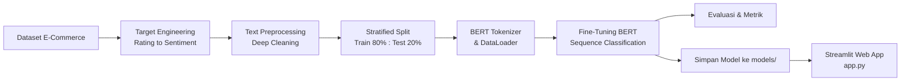
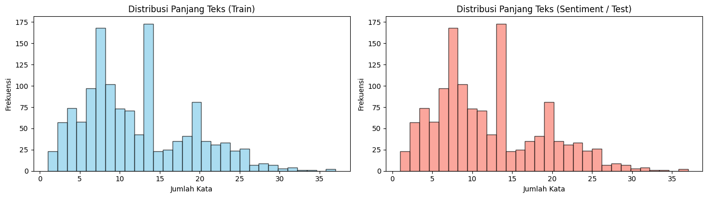

# 🛒 E-Commerce Product Review Sentiment Analysis


Proyek analisis sentimen end-to-end untuk mengklasifikasikan ulasan (*product reviews*) pada data penjualan e-commerce (*merchandise sales*). Model dibangun dengan melakukan *fine-tuning* arsitektur Transformer **BERT (`bert-base-uncased`)** menggunakan PyTorch dan diintegrasikan ke dalam antarmuka web interaktif berbasis **Streamlit**.

---

## 📌 Ringkasan Klasifikasi Sentimen

Sentimen dikelompokkan ke dalam 3 kelas berdasarkan rating bintang ulasan:

| Label Sentimen | Rating Bintang | Keterangan | Emotikon |
| :--- | :---: | :--- | :---: |
| **Negative** | ⭐ 1 - 2 | Ulasan bernada kekecewaan / komplain produk | 😡 |
| **Neutral** | ⭐ 3 | Ulasan biasa / netral tanpa polaritas kuat | 😐 |
| **Positive** | ⭐ 4 - 5 | Ulasan kepuasan pelanggan terhadap produk | 😊 |

---

## ✨ Fitur Utama

- **Analisis Sentimen & EDA Interaktif:** Analisis distribusi rating ulasan berdasarkan kategori produk dan lokasi pemesanan.
- **Deep Text Cleaning:** Pembersihan teks ulasan otomatis (penghapusan tautan/URL, karakter non-ASCII, normalisasi huruf kecil, dan perapihan spasi).
- **Transformer Fine-Tuning (BERT):** Tokenisasi menggunakan `BertTokenizer` serta pelatihan model `BertForSequenceClassification`.
- **Web App Inferensi Real-time:** Aplikasi Streamlit siap pakai (`app.py`) untuk menganalisis sentimen kalimat atau review baru secara langsung.

---

## 📁 Struktur Repositori

```text
├── app.py                            # Aplikasi web inferensi interaktif berbasis Streamlit
├── notebooks/
│   └── e_commerce_sentiment.ipynb    # Jupyter Notebook pipeline: EDA, Preprocessing, Fine-Tuning BERT, Evaluasi
├── models/                           # Direktori penyimpanan bobot model & tokenizer terlatih
├── data/                             # Dataset e-commerce (raw & processed)
├── assests/                          # Grafik visualisasi & hasil EDA
│   ├── download.png                  # Distribusi sentimen
│   └── download (1).png              # Distribusi sentimen per kategori produk
├── requirements.txt                  # Daftar dependensi Python
├── .gitignore                        # Konfigurasi ignore file Git
└── README.md                         # Dokumentasi proyek
```

---

## 🛠️ Pipeline & Metodologi



1. **Target Engineering:** Konversi skor rating (1-5) menjadi 3 kelas sentimen (*Negative*, *Neutral*, *Positive*).
2. **Text Preprocessing:**
   - Membersihkan URL (`http\S+`, `www\S+`).
   - Membersihkan karakter non-ASCII & karakter khusus berlebih.
   - Lowercasing dan pemangkasan whitespace berlebih.
3. **Dataset Splitting & Tokenization:**
   - Pemisahan 80% data latih dan 20% data uji secara terstratifikasi (*stratified*).
   - Tokenisasi menggunakan `BertTokenizer` dengan `max_length=128`.
4. **Fine-Tuning & Training:**
   - Arsitektur: `BertForSequenceClassification` (`bert-base-uncased`).
   - Optimizer: `AdamW` dengan fungsi rugi *CrossEntropyLoss*.
5. **Deployment:**
   - Bobot model disimpan ke folder `models/e-commerce`.
   - UI interaktif dibuat menggunakan Streamlit dengan mekanisme caching (`@st.cache_resource`).

---

## 📊 Hasil Analisis & Evaluasi

### Visualisasi Data (EDA)
Distribusi ulasan dan sentimen pada data e-commerce:

| Distribusi Keseluruhan | Distribusi per Kategori |
| :---: | :---: |
|  | .png) |

### Performa Model pada Data Uji
Evaluasi performa klasifikasi pada data uji (*test set*):

| Kelas Sentimen | Precision | Recall | F1-Score | Support |
| :--- | :---: | :---: | :---: | :---: |
| **Negative** | 1.00 | 1.00 | 1.00 | 370 |
| **Neutral** | 1.00 | 1.00 | 1.00 | 223 |
| **Positive** | 1.00 | 1.00 | 1.00 | 886 |
| **Akurasi Keseluruhan** | | | **1.00** | **1479** |

---

## 🚀 Panduan Instalasi & Menjalankan

### 1. Clone Repositori
```bash
git clone https://github.com/username-kamu/Sentiment-Analyst.git
cd "Sentiment Analyst"
```

### 2. Buat & Aktifkan Virtual Environment (Disarankan)
```bash
# Windows
python -m venv .venv
.venv\Scripts\activate

# Linux / macOS
python3 -m venv .venv
source .venv/bin/activate
```

### 3. Instal Dependensi
```bash
pip install -r requirements.txt
```

### 4. Menjalankan Aplikasi Web Streamlit
Jalankan perintah berikut untuk membuka dashboard analisis sentimen di browser:
```bash
streamlit run app.py
```
Akses aplikasi melalui browser di `http://localhost:8501`.

### 5. Menjalankan Notebook Eksperimen
Untuk menjalankan ulang tahapan preprocessing, EDA, dan pelatihan model:
```bash
jupyter notebook notebooks/e_commerce_sentiment.ipynb
```

---

## 📦 Dependensi Utama

- [PyTorch](https://pytorch.org/)
- [HuggingFace Transformers](https://huggingface.co/docs/transformers/index)
- [Streamlit](https://streamlit.io/)
- [Scikit-Learn](https://scikit-learn.org/)
- [Pandas](https://pandas.pydata.org/) & [NumPy](https://numpy.org/)
- [Matplotlib](https://matplotlib.org/) & [Seaborn](https://seaborn.pydata.org/)

---

## 📝 Lisensi
Proyek ini dilisensikan di bawah lisensi **MIT**. Silakan gunakan dan kembangkan sesuai kebutuhan Anda.